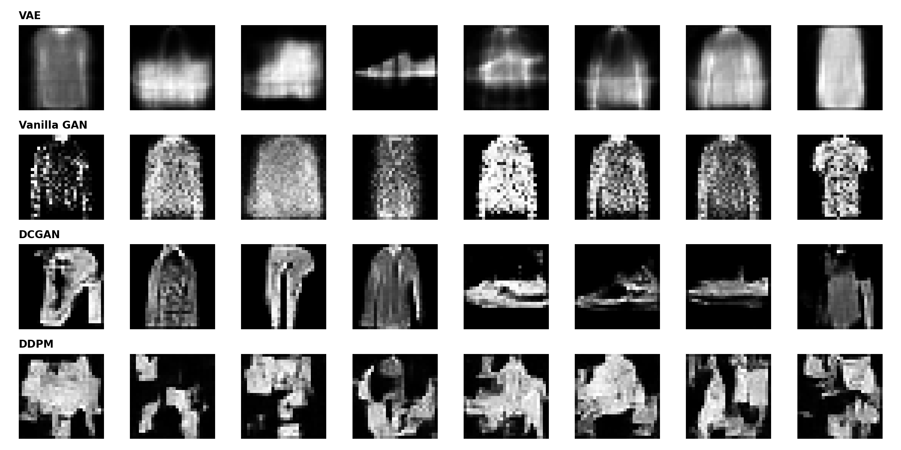

# Comparative Analysis of Discriminative, Reconstructive, and Generative Models on Fashion-MNIST

Implementasi, eksperimen teoretis, dan evaluasi komparatif 7 arsitektur *Deep Learning* yang mencakup paradigma diskriminatif (**MLP Classifier**), berbasis rekonstruksi (**Vanilla AE**, **Sparse AE**, **VAE**), hingga pemodelan generatif murni (**Vanilla GAN**, **DCGAN**, **DDPM**) menggunakan PyTorch pada dataset **Fashion-MNIST**.

---

## Daftar Isi
1. [Latar Belakang dan Tujuan Eksperimen](#latar-belakang-dan-tujuan-eksperimen)
2. [Struktur Repositori](#struktur-repositori)
3. [Arsitektur Model dan Hyperparameter](#arsitektur-model-dan-hyperparameter)
4. [Instalasi dan Panduan Eksekusi](#instalasi-dan-panduan-eksekusi)
5. [Hasil Eksperimen dan Analisis Kuantitatif](#hasil-eksperimen-dan-analisis-kuantitatif)
6. [Analisis Kompleksitas Komputasi](#analisis-kompleksitas-komputasi)

---

## Latar Belakang dan Tujuan Eksperimen

Eksperimen ini dirancang untuk menjawab tiga pertanyaan fundamental dalam *representation learning* dan *generative modeling*:

1. **Batasan Model Diskriminatif (`MLP Classifier`)**:
   - Menguji apakah matriks bobot model klasifikasi berakurasi tinggi dapat dibalik secara langsung menggunakan *Top-Down Weight Transposition* ($W^T$) untuk menghasilkan citra baru.
   - Menganalisis fenomena *information bottleneck* melalui *Frozen Latent Decoding* ($z_{\text{MLP}}$) dan *Prior Sampling* pada ruang laten diskriminatif.
2. **Trade-off Rekonstruksi vs. Regularisasi Laten (`Autoencoder Family`)**:
   - Membandingkan fidelitas rekonstruksi piksel antara *Vanilla Autoencoder* (*bottleneck* terkompresi), *Sparse Autoencoder* (*overcomplete latent* dengan penalti $L_1$), dan *Variational Autoencoder* (VAE dengan regularisasi *KL Divergence*).
3. **Inductive Bias Spasial dan Dinamika Konvergensi (`GAN` dan `Diffusion`)**:
   - Mengevaluasi perbedaan kualitas visual dan distribusi fitur (*FID Score*) antara arsitektur *Fully-Connected* (*Vanilla GAN*), *Fully-Convolutional* (*DCGAN*), dan *Iterative Denoising* (*DDPM U-Net*).

---

## Struktur Repositori

```text
Deep-Learning-Assignment-6-7/
├── dataset.py                  # Pipeline pemuatan dataset Fashion-MNIST (Train, Val, Test DataLoader)
├── models.py                   # Definisi 7 arsitektur jaringan saraf (MLP, AE, SAE, VAE, GAN, DCGAN, DDPM)
├── train.py                    # Modul training loop modular dan penyimpanan checkpoint bobot (.pth)
├── evaluate.py                 # Kalkulasi metrik MSE, PSNR, SSIM, FID Score (Inception-v3), dan plot visual
├── utils.py                    # Utilitas random seed, deteksi device GPU, hitung parameter, dan simpan grid
├── requirements.txt            # Daftar dependensi pustaka Python
├── generative_comparison.png   # Visualisasi komparasi grid hasil sintesis antar-model generatif
└── README.md                   # Dokumentasi lengkap proyek dan laporan hasil eksperimen
```

---

## Arsitektur Model dan Hyperparameter

Seluruh eksperimen dijalankan menggunakan akselerasi GPU **NVIDIA Tesla T4** pada citra Fashion-MNIST berukuran $28 \times 28$ *grayscale* dengan normalisasi rentang piksel $[0, 1]$ (serta $[-1, 1]$ khusus untuk proses difusi DDPM).

| Model | Paradigma | Arsitektur Utama | Dimensi Laten / Noise | Fungsi Objektif (Loss) | Optimizer dan LR | Epochs |
| :--- | :--- | :--- | :---: | :--- | :--- | :---: |
| **MLP Classifier** | Diskriminatif | `Linear(784 → 256 → 64 → 10)` + ReLU | 64 | Cross-Entropy Loss | Adam (`1e-3`) | 15 |
| **Vanilla AE** | Rekonstruksi | Symmetric MLP Encoder-Decoder (`784 ↔ 256 ↔ 64`) | 64 | MSE Loss | Adam (`1e-3`) | 10 |
| **Sparse AE** | Rekonstruksi | Overcomplete MLP (`784 ↔ 256 ↔ 256`) + $L_1$ | 256 | $\text{MSE} + \lambda \Vert{}z\Vert{}_1$ ($\lambda=10^{-3}$) | Adam (`1e-3`) | 10 |
| **VAE** | Laten Generatif | Probabilistic Encoder ($\mu, \log\sigma^2$) + Decoder | 64 | ELBO ($\text{MSE} + D_{KL}$) | Adam (`1e-3`) | 10 |
| **Vanilla GAN** | Adversarial (MLP) | FC Generator & Discriminator + LeakyReLU(0.2) | 100 | Minimax BCE Loss | Adam (`2e-4`, $\beta_1=0.5$) | 15 |
| **DCGAN** | Adversarial (CNN) | `ConvTranspose2d` / `Conv2d` + BatchNorm2d | 100 | Minimax BCE Loss | Adam (`2e-4`, $\beta_1=0.5$) | 15 |
| **DDPM** | Diffusion | U-Net Encoder-Decoder + Skip Connections + Time Embedding | $28 \times 28$ | Noise Prediction MSE ($\epsilon_\theta$) | Adam (`1e-3`) | 15 ($T=1000$) |

---

## Instalasi dan Panduan Eksekusi

### 1. Kloning Repositori dan Instalasi Dependensi
```bash
git clone [https://github.com/username/Deep-Learning-Assignment-6-7.git](https://github.com/username/Deep-Learning-Assignment-6-7.git)
cd Deep-Learning-Assignment-6-7
pip install -r requirements.txt
```

### 2. Menjalankan Training Model
Setiap arsitektur dapat dilatih secara terpisah maupun berurutan melalui fungsi modular di `train.py`:

```python
from utils import set_seed
from train import train_mlp, train_ae, train_vae, train_gan, train_ddpm
from models import (
    VanillaAutoencoder, SparseAutoencoder,
    VanillaGAN_Generator, VanillaGAN_Discriminator,
    DCGAN_Generator, DCGAN_Discriminator
)

set_seed(42)

# 1. Baseline Diskriminatif
train_mlp(epochs=15)

# 2. Keluarga Autoencoder
train_ae(VanillaAutoencoder, "Vanilla AE", epochs=10)
train_ae(SparseAutoencoder, "Sparse AE", epochs=10, is_sparse=True, lambda_l1=1e-3)
train_vae(epochs=10)

# 3. Keluarga GAN dan Diffusion
train_gan(VanillaGAN_Generator, VanillaGAN_Discriminator, "Vanilla GAN", epochs=15)
train_gan(DCGAN_Generator, DCGAN_Discriminator, "DCGAN", epochs=15)
train_ddpm(epochs=15, num_steps=1000)
```

### 3. Evaluasi Kuantitatif dan Generasi Visualisasi
Menghitung metrik rekonstruksi (**MSE**, **PSNR**, **SSIM**) pada seluruh *test set* serta **FID Score** menggunakan fitur ekstraksi **Inception-v3**:

```python
from evaluate import run_full_evaluation

recon_metrics, fid_scores = run_full_evaluation(num_fid_samples=512)
```

---

## Hasil Eksperimen dan Analisis Kuantitatif

### A. Bukti Empiris Batasan MLP Classifier
1. **Performa Klasifikasi**: `MLPClassifier` mencapai akurasi **92.00%** pada *epoch* ke-15.
2. **Top-Down Weight Transposition ($W^T$)**: Proyeksi balik dari vektor *one-hot* kelas target menggunakan matriks transpose bobot menghasilkan pola acak yang tidak menyerupai objek pakaian. Secara aljabar linier, matriks bobot *neural network* tidak bersifat ortogonal ($W^T \neq W^{-1}$), sehingga operasi transpose gagal membalikkan transformasi non-linier *forward pass*.
3. **Frozen Latent Information Bottleneck**: Melatih *decoder* terpisah di atas fitur laten beku ($z_{\text{MLP}}$) menghasilkan rekonstruksi yang kabur (*blurry*) dan kehilangan detail tekstur lokal. Fungsi objektif *Cross-Entropy* memaksa jaringan membuang variasi spasial intra-kelas yang tidak relevan untuk pemisahan kelas.
4. **Prior Sampling pada Ruang Laten MLP**: Penarikan sampel acak dari distribusi laten $z_{\text{MLP}}$ menghasilkan citra tercampur yang tidak koheren karena ruang laten diskriminatif tidak memiliki batasan regularisasi *manifold* probabilistik yang kontinu.

### B. Tabel Perbandingan Metrik Rekonstruksi dan Generatif

| Model | Kategori | MSE $\downarrow$ | PSNR (dB) $\uparrow$ | SSIM $\uparrow$ | FID Score $\downarrow$ |
| :--- | :--- | :---: | :---: | :---: | :---: |
| **Vanilla AE** | Rekonstruksi | 0.0098 | 21.00 | 0.7584 | — |
| **Sparse AE** | Rekonstruksi | **0.0087** | **21.48** | **0.7838** | — |
| **VAE** | Rekonstruksi & Generatif | 0.0230 | 16.87 | 0.5724 | 124.98 |
| **Vanilla GAN** | Generatif | — | — | — | 204.36 |
| **DCGAN** | Generatif | — | — | — | **62.87** |
| **DDPM** | Generatif | — | — | — | 206.19 |

### C. Analisis Hasil Utama
- **Superioritas Rekonstruksi Sparse AE**: Kapasitas laten *overcomplete* (`256`) yang dikombinasikan dengan penalti $L_1$ memungkinkan representasi fitur yang selektif tanpa kehilangan detail penting, mencatatkan nilai error terendah (`MSE: 0.0087`) dan kesamaan struktural tertinggi (`SSIM: 0.7838`).
- **Trade-off Regularisasi KL pada VAE**: Suku *KL Divergence* pada fungsi ELBO berhasil membentuk ruang laten kontinu sehingga sampel baru memiliki siluet global yang utuh (`FID: 124.98`), namun mengorbankan ketajaman rekonstruksi per piksel (`PSNR: 16.87 dB`) akibat perataan ekspektasi kondisional $\mathbb{E}[x|z]$.
- **Pentingnya Inductive Bias Spasial pada DCGAN**: DCGAN memperoleh skor FID terbaik (**62.87**) karena operasi konvolusi transposisi mempertahankan korelasi spasial lokal antar-piksel, sedangkan `BatchNorm2d` menstabilkan dinamika *minimax* antara *Generator* dan *Discriminator*. Sebaliknya, Vanilla GAN (`FID: 204.36`) menghasilkan citra penuh *grainy noise* karena arsitektur *Fully-Connected* memperlakukan setiap piksel secara independen.
- **Perilaku Konvergensi DDPM**: U-Net berhasil menurunkan *Noise MSE Loss* hingga `0.0549` dengan kontras tepian lokal yang tajam, namun koherensi bentuk global pada proses *reverse diffusion* 1000 langkah masih terfragmentasi (`FID: 206.19`) karena arsitektur U-Net ringan tanpa *Residual/Attention blocks* membutuhkan jumlah *epoch* yang jauh lebih panjang untuk menyusun struktur global dari *noise* murni.

### D. Komparasi Visual Hasil Sintesis Citra


---

## Analisis Kompleksitas Komputasi

| Keluarga Model | Kompleksitas Waktu Training | Kompleksitas Latensi Inferensi | Karakteristik Komputasi |
| :--- | :--- | :--- | :--- |
| **MLP / Vanilla AE / Sparse AE / VAE** | $O(N \cdot M)$ per *layer* | $O(W)$ (*Single-pass*) | Komputasi sangat ringan dan cepat, namun terbatas dalam menangkap hierarki spasial 2D. |
| **Vanilla GAN** | $O(N \cdot M)$ per *layer* | $O(W)$ (*Single-pass*) | Inferensi instan, tetapi rentan terhadap osilasi gradien dan *mode collapse* pada ruang piksel berdimensi tinggi. |
| **DCGAN** | $O(C_{in} \cdot C_{out} \cdot K^2 \cdot H \cdot W)$ | $O(W_{\text{conv}})$ (*Single-pass*) | Kompleksitas parameter lebih efisien melalui *weight sharing* konvolusi dengan kualitas generasi instan. |
| **DDPM (U-Net)** | $O(C_{in} \cdot C_{out} \cdot K^2 \cdot H \cdot W)$ | $O(T \cdot W_{\text{unet}})$ ($T=1000$) | Kualitas detail lokal tajam dan stabil saat *training*, tetapi latensi *sampling* $T$ kali lebih lambat karena iterasi *denoising* berurutan. |
